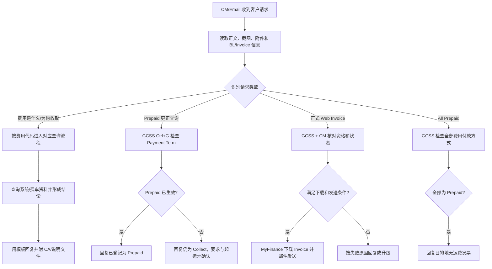

# 《1-Invoice Query 01 - South Korea》文档分析

## 1. 文档概览

- **业务范围**：韩国进出口发票及费用查询（Order to Cash / Billing & Invoicing）。
- **主要入口**：客户通过 Email / Case Management（CM）提交查询。
- **主要处理动作**：识别问题类型、查询账单和费用状态、判断请求方身份、下载发票、按模板回复、附加客户公告（CA）或升级给相关团队。
- **主要查询键**：BL/Shipment Number、Invoice Number、Customer Code/Payer Code、客户公司/Consignee、费用代码。
- **文档包含的场景**：HWS、WDF、Late Payment Fee、SPOT penalty、CPU/CPE、EHI、EPS/PED/SBF、费用 Prepaid/Collect 更正、Web/Official Invoice、All Prepaid。

## 2. 需要使用的系统

| 系统/渠道 | 是否核心 | 用途 | 关键操作或字段 |
|---|---:|---|---|
| **Case Management（CM）** | 是 | 接收客户 Email/Case，查看请求内容、附件和 Service View，回复并关闭/转交 Case | 读取 Subject/Description/附件；核对 Account Name、Contact Email、SCV Code；进入 **Service View** |
| **GCSS（Global Customer Service System）** | 是 | 打开 Bill/Shipment，核对费用、付款方式、客户角色及发票状态 | 按 BL/Shipment 查询；`Ctrl+G` 打开价格页；查看 Charge Type、Payment Term（Prepaid/Collect）、Invoice Party、Collection Business Unit、Print；查看 Consignee；查看 SCIR 状态；查看 Shipment Notes |
| **Maersk.com / MyFinance** | 是 | 查询、下载正式 Web Invoice；客户也可自行查询 | 用 Customer Code 登录；按 Shipment/Invoice Number 搜索；切换 Customer/Agent；选择并下载 Invoice |
| **Email / Outlook** | 是 | 接收请求、发送模板回复和附件、联系支持团队 | 附加 Invoice、Customer Advisory（CA）、费用说明文件；必要时联系 Origin、财务或发票生成团队 |
| **WDF Charge Compliance - Power BI** | 特定场景 | 查询 WDF 的计算/合规信息 | 按 shipment/container 查询 WDF 触发原因及计算依据 |
| **Booking Journey / Maersk Spot 页面** | 特定场景 | 获取 HWS 最新费率文件；在订舱前查看 SPOT 条款和费用 | Price breakdown 中下载 HWS 文件；查看 Spot Terms → Commitments and Damages → Fees |
| **GCSS Shipment Notes** | 特定场景 | 查询已订舱 SPOT penalty | Shipment Notes → Reason type `User Defined` → `Penalty fees`，读取 Comments 中 Amendment/Cancellation/No-show/Compensation Fee |
| **Excel/费率文件/客户公告（CA）** | 辅助资料 | 按航线、箱型、日期、重量等核对费率并作为客户回复附件 | 使用最新版文件，核对 Last Update、Origin、Destination、Equipment、VGM、Tariff、Valid From/To |
| **ISR（Internal Service Request）** | 特定场景 | CPU/CPE 金额疑似错误时向起运地团队核查 | 创建并发送 ISR to Origin，同时告知客户联系起运地合作方 |

## 3. 总体处理流程

## 4. 通用输入、检查项和输出

### 4.1 输入

- 客户 Email/Case 内容及主题关键词。
- BL/Shipment Number、Invoice Number。
- 客户截图或附件中的费用代码、金额和币种。
- Customer Code/Payer Code、Email Sender Company。
- GCSS 中的 Consignee/Switched Consignee/Document Consignee、费用行和发票状态。

### 4.2 通用检查

1. 确认请求是“费用解释”“费用错误/更正”“发票下载”还是“无目的地发票”。
2. 核对业务方向（韩国进口/出口）和 BL/Shipment。
3. 核对请求方身份及付款方，避免向非实际收货人直接发送正式发票。
4. 检查截图和附件，确认客户询问的具体费用代码。
5. 使用最新费率/公告文件；涉及航线费率时同时核对生效日期、箱型和航线。

### 4.3 输出

- 标准 Email 模板回复。
- 正式 Invoice 附件，或 Customer Advisory/费用说明文件。
- ISR/内部升级请求。
- 对无法处理场景的明确引导（客户自助下载、联系其他国家客服、联系 Origin/财务/发票生成团队）。

## 5. 分场景操作

### 5.1 HWS（Heavy Load Surcharge）

1. 在 Booking Journey 的 Price breakdown 中打开 HWS 说明链接并下载最新 Excel。
2. 核对文件的 Last Update、Origin、Destination、Equipment、Commodity、VGM、Validity、Tariff，以及是否适用于 SPOT/MaerskGo。
3. 依据最终提交的 VGM 判断是否达到对应航线阈值；HWS 通常不会在 SPOT 初始费用 breakdown 中提前固定显示。
4. 向客户说明是否适用及费率，并建议其参考最新文件。

### 5.2 WDF（Weight Discrepancy Fee）

1. 在 **WDF Charge Compliance - Power BI** 查询费用触发原因和计算结果。
2. 核对以下规则：首次 SI Weight 与 VGM 差值绝对值是否大于 3,000 kg；VGM 是否低于箱体 Tare；VGM 是否高于 Max Gross Weight。
3. 正常触发时回复规则和计算依据；文档给出的标准费用为 USD 300/Container。
4. 客户申请 Waiver 时，说明非系统问题原则上不减免。
5. 若客户声称系统错误（如 Split TP Doc），先回复“进一步核查”，再进入人工调查/升级。

### 5.3 Late Payment Fee（LPF）

1. 核对客户是否为 Non-credit，以及 Invoice Date、付款日期、工作日节假日和 ATD 延误情况。
2. 按文档规则解释：Invoice 发出后前 7 天免费，自第 8 天起按周期累计；工作日中的公共假期不计入到期日。
3. 一般 Waiver 请求按模板拒绝。
4. 若客户已在期限内转账、仅入账处理延迟，引导联系 `KR.PAYMENT.OCEAN@MAERSK.COM` 申请删除费用。
5. ATD 延误 3 天及以上时，以 ATD 作为计算起点；1-2 天延误仍按 Invoice Date 计算。

### 5.4 SPOT Penalty / Rollable Compensation

**已订舱：**

1. 在 GCSS 打开 Shipment。
2. 进入 Shipment Notes → `User Defined` → `Penalty fees`。
3. 在 Comments 查看 Amendment、Cancellation、No-show、Compensation Fee。

**订舱前：**

1. 打开 Maersk Spot Terms。
2. 进入 `Commitments and Damages` → `Fees`，按航线、箱型、订舱日期读取费率。

**回复规则：**

- 因客户原因在订舱后修改/取消：说明按箱收取 Penalty，通常不予 Waiver。
- 因承运人可控原因发生 Roll-over：按条款判断 Rollable Compensation；使用补偿金额时联系财务团队。
- 回复时附 SPOT Guide/FAQ/适用费率文件。

### 5.5 CPU/CPE（Container Protect）

1. 在 Email/附件中识别客户是询问“费用含义”还是“金额错误”。
2. 如仅询问费用含义：说明该目的地费用覆盖集装箱清洁、维护和维修，并附 CA。
3. 如质疑金额：告知需与起运地确认，并创建 ISR to Origin。
4. 必要时在 MyFinance 或 CM Service View 查询 Invoice：输入 Shipment/Invoice Number、Customer Code，选择对应 Invoice。
5. 费率判断需结合箱型、货物类型及保障方案；金属/电池货物适用 CPU/Unlimited，SOC 不适用。

### 5.6 EHI（Equipment Handling Import，原 MHI）

1. 识别 MHI/EHI 费用询问。
2. 说明费用代码由 MHI 更名为 EHI，业务实质不变。
3. 对韩国进口冷藏箱，文档口径为 KRW 40,000/Container。
4. 回复该费用用于冷藏/冷冻集装箱返还时的正常运行检查，并附相关 CA。
5. 发票可通过 MyFinance 或 CM Service View 查询。

### 5.7 EPS/PED/SBF（Equipment Positioning Service - Import）

1. 阅读 Email、客户截图和附件，确认费用代码、Shipment、航线及具体诉求。
2. 依据费率表核对 Origin/Corridor、箱型和当前生效日期。
3. 向客户说明 SBF 已由 PED/EPS（Equipment Positioning Service - Import）替代，并由韩国目的地支付。
4. 使用标准模板回复，并附客户公告文件。

### 5.8 Prepaid/Collect 更正查询

1. 从 CM 接收包含“Prepaid 정정 여부 확인”等关键词的请求。
2. 在 GCSS 打开 Bill，按 `Ctrl+G` 进入价格页。
3. 找到客户提及的 Charge Type，读取 `Payment Term`。
4. 若已为 `Prepaid`：回复系统已登记为 Prepaid。
5. 若仍为 `Collect`：回复当前仍为 Collect，并要求客户与起运地业务团队再次确认更正情况。
6. 同时可核对 Invoice Party、Collection Business Unit 和 Print 字段，防止只看费用名称造成误判。

### 5.9 Web/Official Invoice 请求

**识别关键词：** `INV 업로드`、`인보이스 요청`、`웹 인보이스 요청`、Web Invoice，以及 KRW/外币合并或拆分发票请求。

1. 在 GCSS 打开 Bill，检查 **SCIR status**。
2. 若 `Open`：需要人工 Review，不能直接发送。
3. 若 `Closed`：继续核对请求方是否为 Actual CNEE（实际 Consignee）。
4. 同时确认：
   - Web Invoice 已可下载；
   - 目的地为 South Korea；
   - Email Sender Company 与 Consignee/Switched Consignee/Document Consignee 一致；
   - Collect Payer Code 为韩国客户（文档说明以 `418` 开头）；
   - 不存在超出本 SOP 的特殊要求。
5. 全部满足时，在 Maersk.com → MyFinance 按 BL/Invoice 查询并下载正式 Invoice，以附件回复客户。
6. 若未生成/不可下载：邮件联系 `APAUBSO@maersk.com` 请求生成 Web Invoice。
7. 若目的地不是韩国：要求客户检查 BL 或联系对应国家客服。
8. 若请求方不是 Actual CNEE：不得直接发送；引导实际 Consignee 提供，或由客户登录 MyFinance，以 Agent 身份按 BL 自助查询。USD Invoice 可能不允许第三方查看。
9. 若 Payer Code 属于其他国家：引导客户联系对应国家客服。

### 5.10 All Prepaid

1. 在 GCSS 打开 Bill，按 `Ctrl+G` 进入价格页。
2. 逐项检查所有 Charge 的 `Payment Term` 是否均为 `Prepaid`。
3. 若全部为 Prepaid，回复客户：该票为 All Prepaid，目的地没有需要处理的 Freight Invoice。

## 6. 自动化/标准化建议

### 6.1 可自动化部分

- 根据 Subject/正文关键词对 Case 分类。
- 从正文、截图 OCR 或附件中提取 BL、Invoice Number、费用代码和 Customer Code。
- 调用或驱动 GCSS/CM 查询后，结构化采集 Charge Type、Payment Term、Consignee、SCIR Status。
- 根据决策表选择回复模板及必需附件。
- 对 HWS/SPOT/EPS 等费率文件进行版本和生效日期校验。

### 6.2 必须保留人工判断的部分

- 客户截图/附件语义不明确或一个 Case 包含多个诉求。
- WDF 系统错误、Split TP Doc 等异常调查。
- SCIR 为 Open、Invoice 未生成、客户身份不一致。
- Waiver、补偿、跨国家/跨团队责任归属。
- 任何涉及向客户发送正式财务文件前的身份与权限确认。

## 7. 文档中的风险和待确认项

1. **标题/元数据不一致**：首页标题是 South Korea，但元数据一处写作 `Invoice Query-Japan`，应以实际业务内容和后段 `Invoice query - South Korea` 为准并修正文档。
2. **版本日期异常**：后段元数据显示 `2026.07.29`，晚于当前文档分析日期，需确认是否为计划版本或录入错误。
3. **LPF 天数表述不一致**：定义段写“10 天后”，规则和模板写“7 天免费、第 8 天起收费”；执行前应由流程 Owner 确认唯一口径。
4. **EHI 生效日期不一致**：正文写 2023-06-01 起更名，另有 `Effective date: 2023-2-17`；需确认公告日与正式生效日。
5. **EPS/PED 命名混用**：文档同时使用 EPS 与 PED，应在系统费用代码和客户展示名称之间建立明确映射。
6. **费率有时效性**：HWS、SPOT、EPS/PED 等费率必须以最新在线文件/公告为准，不能仅依赖本文静态金额。
7. **数据保护**：文档截图包含客户名称、邮箱、SCV Code、BL 等信息；分析与自动化产物应避免复制真实客户数据，并限制访问权限。

## 8. 最小权限清单

- Case Management：读取/更新 Case、Service View、附件及回复权限。
- GCSS：Shipment/Bill、Pricing、Invoice、Shipment Notes、Consignee 和 SCIR 状态读取权限。
- Maersk.com/MyFinance：按 Customer/Payer/Agent 身份查询和下载 Invoice 的权限。
- Power BI：WDF Charge Compliance 报表读取权限。
- Email：客户回复、附件发送及联系 Origin/Finance/Invoice Generation 团队的权限。
- 共享资料库：HWS、SPOT、EPS/PED、Container Protect、EHI 最新 CA/费率文件读取权限。